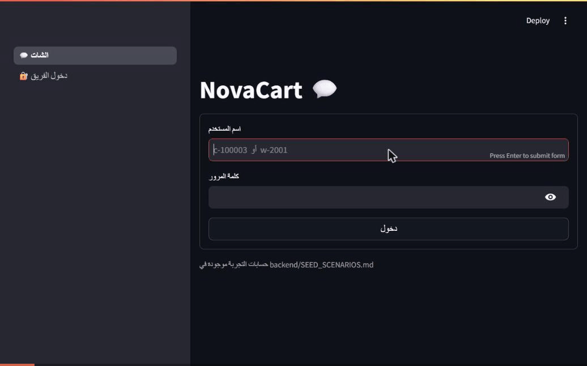

# NovaCart — Adaptive AI Gateway

[](https://github.com/abdo223355/ecmorce-Ai-agent/actions/workflows/tests.yml)


An AI support layer for a fictional e-commerce company (NovaCart). Customers and delivery workers chat with it
in Arabic or English. It answers from **live backend data** and **company policies (RAG)**, decides eligibility
**in code** (never by the model), and **hands off to a human** when it should.

This is a learning + portfolio project. The goal was to understand how to build an agent, so the repository keeps
the reasoning: written design decisions (D1–D160), a session log, and an honest list of the quality problems
found and fixed, with numbers.

## How it was built

Abdelrahman owns the software architecture and the system design: the idea, the phases, the design decisions,
the prompts, the test data and the evaluation sets. He decided what to build and how it should work, reviewed the
results, and decided what to change.

**Claude Code (Anthropic's coding assistant) was his assistant on the project.** It wrote the code and drafts of
the documents from his instructions. The code was then run, measured and corrected against real messages before it
was kept.

## Demo



A demo customer asks whether orders can be cancelled, in Arabic and in English. The verdict comes from code that reads
the order's status; the model only phrases the answer. A order in Processing is passed to a person instead of guessed.

## The idea in one picture

```
website / chat screen
        |  token (identity comes only from the verified token)
        v
   Gateway (FastAPI)  --->  P1 safety pattern check (code)
        |                   scrub typed order numbers into placeholders
        v
   customer agent  or  delivery-worker agent   (chosen by code from the token role)
        |
        |  classify (LLM, structured output)  ->  safety gate (code)  ->  fixed tool plan per intent (code calls tools)
        |                                                                    |
        |                           backend data . policy search (RAG) . eligibility rules (code)
        v
   reply (LLM writes, or code builds the text) -> validate -> assemble
        |
        v  answer, or a handoff to Customer Service / dispatch
```

Rules the code never breaks:
- The model never sees identity, token or customer id.
- Numbers, dates and order ids in a reply are placeholders filled in by code.
- Cancellation, return and exchange eligibility are pure functions of the order data (`gateway/app/rules/`).
  Things the data cannot show (item condition, stock) are told as the policy's condition or sent to a person.
- No free tool loop: each intent has a fixed plan. Message text is never logged.

## What is built

| Part | Where |
|---|---|
| NovaCart backend: Flask + PostgreSQL, JWT (RS256), seeded realistic data | `backend/` |
| Gateway: identity, backend client, tools, audit events, handoff outbox | `gateway/app/` |
| Agents: LangGraph graph, classify, safety gate, plans, clarify, reply, assemble | `gateway/app/agent/` |
| RAG: chunking, embeddings, pgvector store, retrieval over the policy corpus | `gateway/app/rag/` |
| Eligibility rules: cancellation, return, exchange (one module per policy) | `gateway/app/rules/` |
| Short-term memory (a pending-choice card in Redis, 30 min) | `gateway/app/memory.py`, `agent/pending.py` |
| LLM adapter with per-node models and an 8 s latency budget | `gateway/app/llm/` |
| Chat screen, staff views and an admin dashboard (Streamlit) | `ui/` |
| Evaluation scripts that run the real system | `gateway/evals/` |

## Quality, measured on natural messages

A green test suite did not mean the agent was useful: hundreds of tests passed while "hi" answered "I could not
finish". So the project measures natural messages through the real `/chat` (`gateway/evals/quality_eval.py`).

| Stage | Acceptable answers |
|---|---|
| First working version | 45% |
| After small talk, typed order numbers, missing plans | 78% to 87% |
| After retry on timeout and a proper classifier prompt | 92% to 96% |
| After lists, memory and eligibility answers | 98% to 100% (single runs vary by a point or two on provider timeouts) |

The classifier prompt reached 100% on its 72-message set and 54/54 on held-out messages written after tuning.

## Problems we found, and how we solved them

Full detail (how each was found, the cause, the change, the numbers before and after) is in
[`docs/QUALITY_AND_FIXES.md`](docs/QUALITY_AND_FIXES.md).

| # | Problem | Cause | Fix |
|---|---|---|---|
| 1 | "hi" answered "I could not finish" | a greeting has no request, and an empty turn became the failure text | small talk is answered by code, with no model call |
| 2 | A typed order number was not understood | the ingress scrub did not exist | the number becomes `{order_ref_N}` before the agent; only code keeps the real id |
| 3 | Some intents had no plan | plan rows were missing | rows added; the rest hand off honestly |
| 4 | Slow and failing model calls | one attempt, fixed caps, and our own parallel load | bounded retry on timeout only; measured one at a time |
| 5 | Written answers thrown away silently | no reason was recorded | each refusal records its reason code |
| 6 | The classifier prompt was two sentences | never tuned | a full prompt, then checked on held-out messages |
| 7 | The screen showed raw codes and ISO dates | no presentation layer | readable statuses and dates in the user's language |
| 8 | "Return status" said "not found" | the agent searched orders, not returns | a new `GET /customer/returns` endpoint and a list-based plan |
| 9 | "Where is my order?" asked an unanswerable question | no list of orders on the way | code-built list, 0.1 s, no model call |
| 10 | "2" was not understood after the agent's own list | no memory | a pending-choice card in Redis; code resolves "2", "the second" or a product name |
| 11–13 | "Can I cancel / return / exchange?" always went to a person | eligibility not built | rules in code, per policy, tested on the policy's edge days |
| 14 | Security and operations review | reviewing our own work | see the last section of the fixes file |

Decisions where the policy PDFs were silent or ambiguous are listed in
[`docs/ELIGIBILITY_DECISIONS.md`](docs/ELIGIBILITY_DECISIONS.md), so they are not mistaken for official policy.

## Run

```
cp .env.example .env     # fill in your own values; .env is never committed
docker compose up --build
```

- Chat screen: http://127.0.0.1:8501
- Backend health: http://127.0.0.1:8000/health, Gateway health: http://127.0.0.1:8080/health
- `OPENROUTER_API_KEY` is needed for the model calls. Use a provider with no data retention.
- Phone numbers for the fallback text (`CS_PHONE`, `EMERGENCY_PHONE`, `DISPATCH_PHONE`) are yours to fill in; none is invented.

## Demo accounts

- Password for all demo customers and workers: `NovaCart#2026` (demo data only).
- Customers `c-100001` to `c-100010` hold hand-made policy edge cases, and `c-100201` to `c-100205` hold orders in every state.
- Workers `w-2001` to `w-2005`.
- What each account is good for: [`backend/SEED_SCENARIOS.md`](backend/SEED_SCENARIOS.md) and [`backend/SEED_MORE.md`](backend/SEED_MORE.md).
- The edge cases are dated relative to the day the data was seeded. On a later day, re-seed:

```
docker compose run --rm --no-deps --entrypoint python -v ./backend:/src -w /src backend -m novacart_backend.seed --reset
docker compose run --rm --no-deps --entrypoint python -v ./backend:/src -w /src backend -m novacart_backend.seed_more
```

Try questions such as: `ينفع ألغي NC-100014؟`, `can I cancel order NC-100015?`, `ينفع أرجّع NC-100001؟`, `ينفع أبدّل NC-100001؟`.
Phrasing matters by design: "I want to cancel" is a request to act, which the agent hands to a person;
"can I cancel?" asks about eligibility, which the agent answers.

## Tests

```
cd backend && pip install -r requirements.txt && pytest -q tests
cd gateway && pip install -r requirements.txt && pytest -q
```

Quality runs against the real stack (need a model key): `python gateway/evals/quality_eval.py`,
`stability_eval.py`, `classify_eval.py`.

## Known limits (stated honestly)

- Eligibility covers cancel, return and exchange. The data has no sub-category for small appliances, no item
  condition, no exchange stock and no processing start time, so those are told as conditions or sent to a person.
- Only order numbers are scrubbed at ingress. The rest of the personal-data scrub and a final output validation are not built.
- Memory is a first slice (a pending list). There are no earlier-turn cards, so "why?" is not understood from memory.
- No circuit breakers or degraded mode. No TLS (local use only). A known admin name can be locked for 15 minutes by 5 wrong tries.
- The quality sets are small (52 to 72 messages). About 3% of requests still fail on a model timeout.
- Much of the Arabic and English wording is a draft that the project owner is still reviewing.

## Where to read more

- `docs/design/` — the design phases and decisions D1–D160 (source of truth).
- `docs/PROGRESS.md` — the session log: what was decided, what is open.
- `docs/QUALITY_AND_FIXES.md` — problems found and fixed, with numbers.
- `docs/ELIGIBILITY_DECISIONS.md` — decisions taken where the policies are silent.
- `CLAUDE.md` — the working rules given to Claude Code, the coding assistant used on this project.
